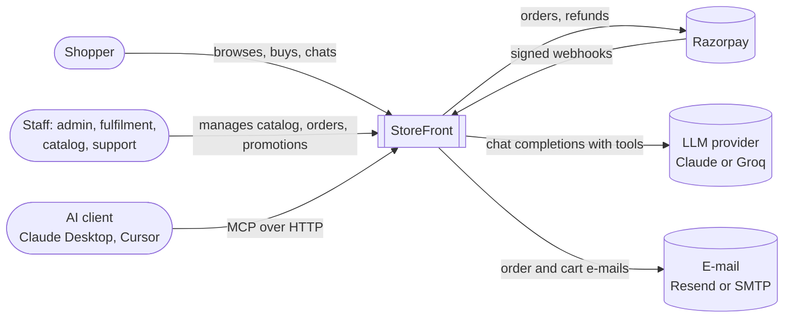
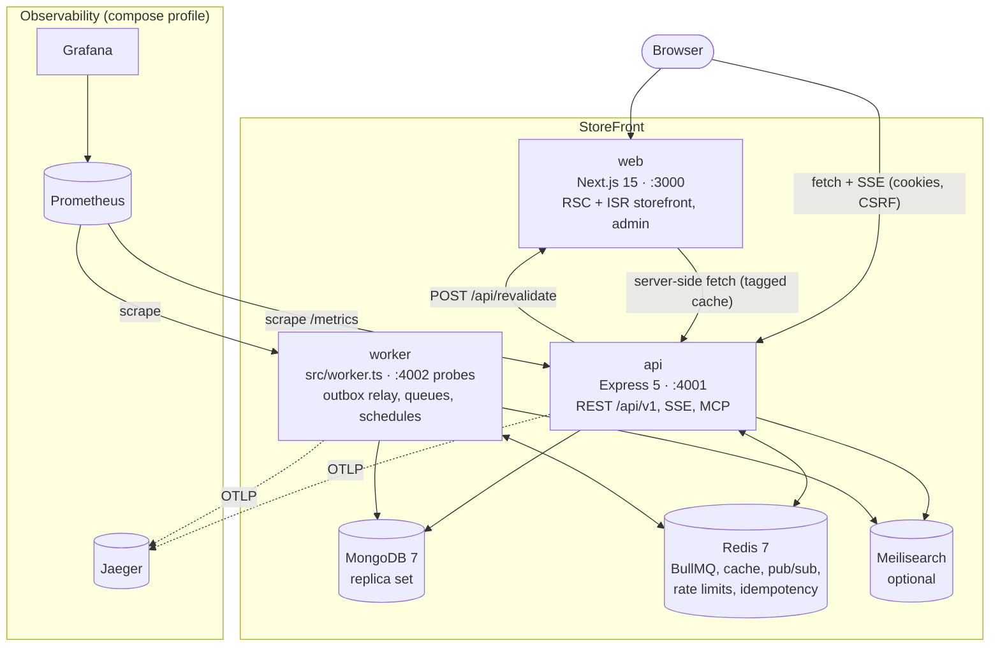
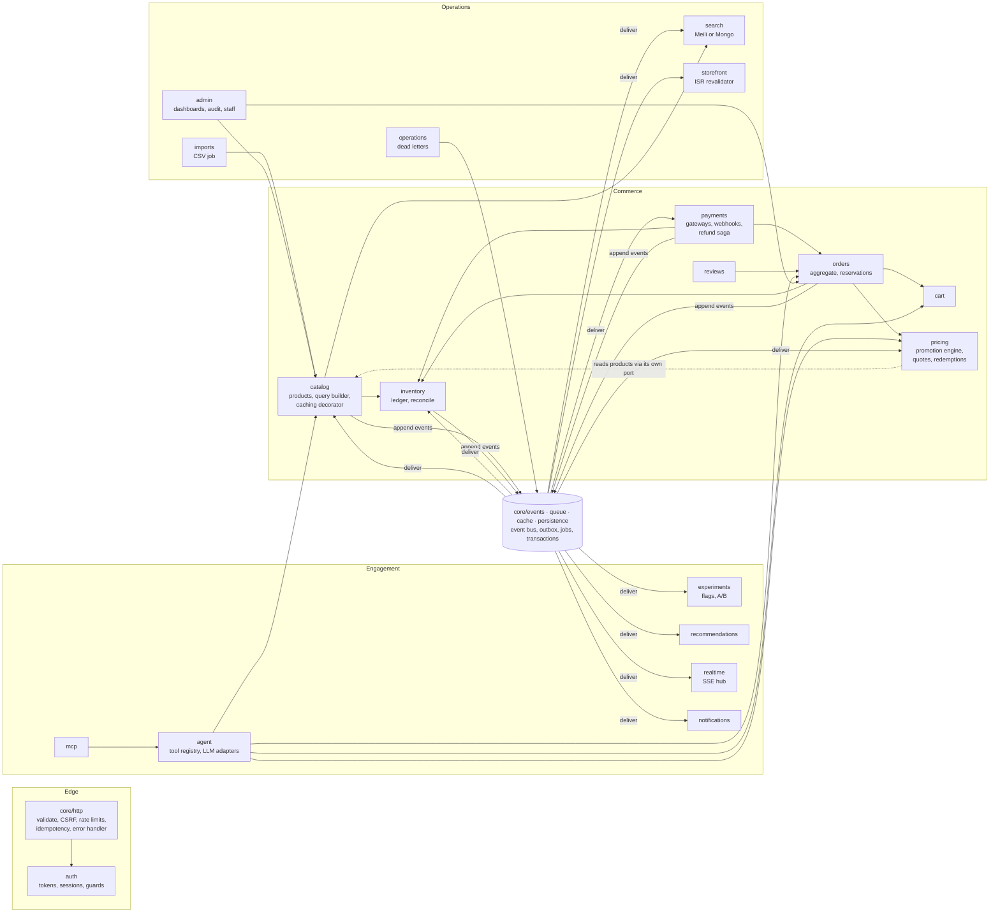
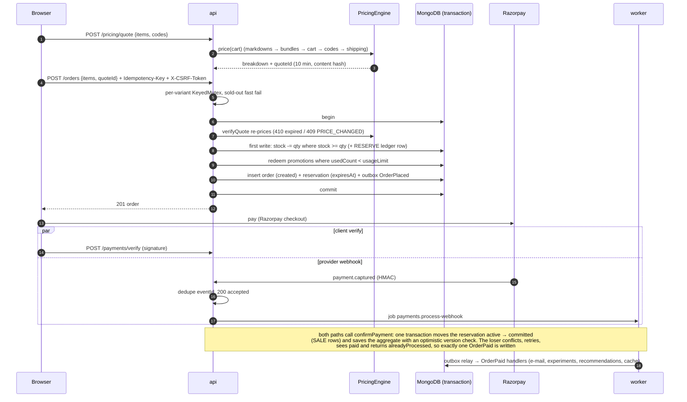
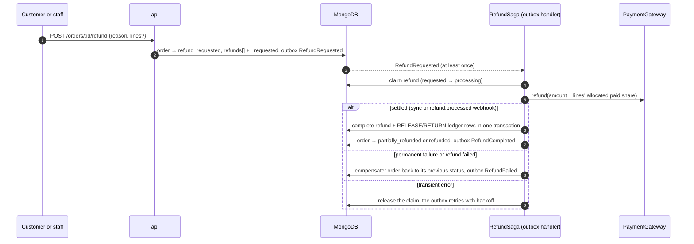

# StoreFront

A full-stack commerce platform built to production standards: a Next.js 15 storefront and admin, a
TypeScript modular-monolith API, and a background worker. Behind the shop sits a data-driven
**promotion engine** that uses branch-and-bound search to find the cheapest valid combination of
overlapping offers. Checkout is **concurrency-safe**: under a 300-buyer race for the last 50 units it
sold exactly 50. Every side effect leaves through a **transactional outbox**, refunds run as a
**saga with compensation**, and an **AI shopping assistant** acts on the store through tools, with
customer confirmation before any write. Redis, Meilisearch and the observability stack are optional;
without them the same code runs on in-memory implementations.

**Demo accounts:**
- Customer: `customer@storefront.dev` / `Customer@123`
- Admin: `admin@storefront.dev` / whatever you set as `ADMIN_PASSWORD`. Docker Compose defaults it to `Admin@12345`; without it the admin account is not created.

## Highlights

- **Promotion engine as data.** Fixed bundles, mix-and-match, buy-X-get-Y, spend tiers, percent/flat
  codes, free shipping, flash sales and stock-age clearance are stored as versioned JSON rules. The engine:
  - builds conditions with Composite/Specification and actions with Strategy
  - packs bundles optimally with branch-and-bound
  - allocates every discount to lines to the paisa
  - explains its choices and suggests near misses ("add one more tee to save ₹300")
- **Checkout you can race.** The client gets a verified price quote, then stock is reserved inside a
  MongoDB transaction with an expiring reservation and an append-only inventory ledger. Promotion usage is
  counted atomically and `Idempotency-Key` replays are safe.
- **Payments and refunds.**
  - A `PaymentGateway` strategy (Razorpay or demo) wrapped in retry and a circuit breaker.
  - HMAC-verified webhooks, deduplicated and processed by a job.
  - Atomic, idempotent payment confirmation that wins the verify-vs-webhook race.
  - A refund saga with per-line partial refunds and compensation.
- **Event-driven platform.**
  - Typed domain events written to a transactional outbox and relayed through BullMQ, with retries and a dead-letter queue.
  - A separate worker process.
  - Notifications and abandoned-cart reminders.
  - Cache invalidation, search indexing and storefront revalidation, all driven by those events.
- **AI assistant (Aria).**
  - Tools are Command objects in one registry that also generates the MCP server.
  - Groq and Claude adapters behind an `LLMProvider` interface.
  - Streaming over SSE.
  - Prompt-injection defences, with confirm-before-write actions.
  - Token cost tracking and a graded eval suite.
- **Growth and back office.**
  - Feature flags and A/B experiments with a two-proportion z-test.
  - Frequently-bought-together recommendations mined with association rules.
  - Live order and stock updates over SSE.
  - CSV bulk import.
  - A promotion rule builder and simulator.
  - An operations console for dead letters and stock reconciliation.
  - A generated OpenAPI 3.1 reference.
- **Security.**
  - Rotating refresh-token families with reuse detection.
  - Signed double-submit CSRF.
  - IP+email login throttling.
  - Permission-based RBAC with an audit log.
  - A server-side cart trust boundary.
  - CodeQL and Dependabot in CI.
- **Storefront.**
  - Server Components with ISR, refreshed by event-driven tag revalidation.
  - JSON-LD and sitemaps.
  - TanStack Query, invalidated by realtime events.
  - Lighthouse 99–100 on desktop.

## Tech stack

| Layer | Technology |
|---|---|
| Frontend | Next.js 15 (App Router, Server Components, ISR), React 19, TypeScript, Tailwind, Radix/shadcn UI, TanStack Query |
| API | Node.js, Express 5, strict TypeScript, zod (validation, env, OpenAPI via `zod-to-openapi`) |
| Shared contracts | `@storefront/contracts`: zod schemas, DTO types, order transitions, RBAC map, paise money helpers |
| Data | MongoDB 7 (replica set, multi-document transactions), Mongoose, versioned migrations |
| Jobs and messaging | BullMQ on Redis 7 (optional), transactional outbox, Redis pub/sub |
| Search | Meilisearch 1.15 (optional) or MongoDB text search |
| Payments | Razorpay (cards, UPI, netbanking) or a built-in demo gateway |
| AI | Anthropic Claude or Groq through `LLMProvider`; Model Context Protocol server |
| Observability | pino with request ids, Prometheus (`prom-client`), OpenTelemetry tracing, Grafana and Jaeger |
| Testing | Vitest, Supertest, mongodb-memory-server, fast-check, Playwright, Lighthouse CI, k6 |
| Delivery | npm workspaces, Docker multi-stage non-root images, Docker Compose, GitHub Actions, Render blueprint |

## Quickstart

### Everything in Docker

```bash
cp .env.example .env            # optional: Razorpay, LLM and e-mail keys; defaults work without it
docker compose up --build       # web :3000 · api :4001 · worker · mongo (replica set) · redis · meilisearch
docker compose --profile observability up --build   # adds Jaeger :16686, Prometheus :9090, Grafana :3001
```

Open http://localhost:3000. The API applies migrations and seeds the demo catalog (60 products, about
110 historical orders and 9 overlapping promotions) on first start.

### Local development without Redis

MongoDB has to run as a replica set, because checkout uses transactions. Redis and Meilisearch are
optional: without them the API runs jobs in-process and searches with MongoDB.

```bash
docker run -d --name sf-mongo -p 27017:27017 mongo:7 --replSet rs0
docker exec sf-mongo mongosh --quiet --eval 'rs.initiate()'

npm install
cp .env.example backend/.env    # set MONGO_URL=mongodb://localhost:27017/?replicaSet=rs0, JWT_* secrets, ADMIN_PASSWORD
echo 'NEXT_PUBLIC_API_URL=http://localhost:4001' > frontend/.env.local
npm run dev:api                 # migrate + seed, then the API on :4001
npm run dev:web                 # Next.js on :3000
```

For a stack with no database to install, `npm run e2e:api -w backend` boots the API on an in-memory
replica set with the demo seed on :4801. That's the server the Playwright suite uses.

### Demo accounts and `ADMIN_PASSWORD`

There is no default admin password in code. The seed creates `ADMIN_EMAIL` (default
`admin@storefront.dev`) only when `ADMIN_PASSWORD` (at least 8 characters) is set. On every later
start the admin's password is rotated to match the variable if it changed, and without the variable
the admin seed is skipped and nothing is touched. The demo customer `customer@storefront.dev` / `Customer@123`
and four demo buyers are seeded with the catalog. Set `SEED_DEMO_DATA=false` to skip demo data entirely.

## Architecture

The diagrams follow the [C4 model](https://c4model.com). [docs/architecture.md](docs/architecture.md)
covers module boundaries, the consistency model, the optimizer and failure modes, and
[docs/adr/](docs/adr/README.md) records the key decisions.

### System context



### Containers



Without `REDIS_URL` the api container runs the worker's jobs itself (`JOBS_IN_PROCESS=auto`).

### Backend components

Each module in `backend/src/modules/<name>` is routes → controller class → service class → repository
class. Every class is constructed in one composition root (`backend/src/core/container.ts`).
Infrastructure is chosen in `backend/src/core/infrastructure.ts`.



Modules call each other through constructor-injected services and react to each other through
domain events: the refund saga, cache and search invalidation, notifications, experiment conversions,
promotion releases, realtime fan-out and storefront revalidation are all event handlers. Only the
composition root knows concrete classes.

## Key flows

### Quote → checkout → payment



### Refund saga



The full lifecycle diagram and every consistency guarantee, each with the test that proves it, are in
[docs/orders-and-payments.md](docs/orders-and-payments.md).

## Design patterns in the code

| Pattern | Where | Why |
|---|---|---|
| Composition root / constructor injection | `backend/src/core/container.ts`, `core/infrastructure.ts` | One place picks concrete classes (Redis or memory, Razorpay or demo) |
| Repository | `modules/*/*.repository.ts`, e.g. `orders/order.repository.ts` | Services never touch Mongoose; tests swap storage freely |
| Aggregate + state machine | `orders/order.aggregate.ts`, `packages/contracts/src/orders.ts` | Order invariants and the audited transition table in one place |
| Strategy | `payments/gateways/payment-gateway.ts` (Razorpay, demo), `search/search.provider.ts`, `notifications/providers.ts`, `pricing/domain/actions.ts` | Swappable providers and discount types |
| Factory | `payments/gateways/payment-gateway.factory.ts`, `agent/llm/llm-provider.factory.ts`, `search/search.factory.ts` | Choose the implementation from config |
| Adapter | `agent/llm/anthropic.provider.ts`, `agent/llm/groq.provider.ts` | Normalise two vendor tool-calling and streaming APIs |
| Decorator | `catalog/caching-catalog.ts`, `payments/gateways/resilient.gateway.ts`, `agent/llm/resilient.provider.ts`, `pricing/instrumented-pricing.service.ts` | Caching, retry, circuit breaking and metrics without touching core logic |
| Specification + Composite | `pricing/domain/conditions.ts` (`AllOf`, `AnyOf`, `Not`, `CartContains`, …) | Promotion eligibility rules that nest |
| Interpreter | `pricing/domain/condition.factory.ts`, `pricing/domain/action.factory.ts` | Turn stored JSON rules into objects |
| Chain of Responsibility | `pricing/domain/stages.ts` (`MarkdownStage` → `BundleStage` → `CartDiscountStage` → `ShippingStage`) | An ordered pricing pipeline |
| Builder | `catalog/product-query.builder.ts` | One query builder shared by the catalog, the agent and MCP |
| Observer | `core/events/event-bus.ts` | Modules react to domain events without knowing each other |
| Transactional outbox | `core/events/outbox.store.ts`, `outbox-relay.ts`, `queue-outbox-relay.ts` | Events commit with the state change and are delivered at least once |
| Saga with compensation | `payments/refund.saga.ts` | Refunds across our database and the payment provider |
| Command + registry | `agent/tools/agent-tool.ts`, `agent/tools/tool-registry.ts` | Each AI tool is a validated, permissioned command; MCP is generated from the registry |
| Circuit breaker + retry | `core/resilience/circuit-breaker.ts`, `core/resilience/retry.ts` | Fail fast when a dependency is down; back off with jitter |
| Unit of work | `core/persistence/transaction.ts` (`TransactionRunner`) | Transactions with jittered retry on write conflicts |
| Ports and adapters | `pricing/pricing.ports.ts` | The pricing domain has no Mongo dependency, so it is property-testable |

Paths are relative to `backend/src/` unless they start with `packages/`.

## Headline numbers

All measured on one M2 laptop with pinned container limits. Read them as relative, not as production
capacity. Methodology is in [docs/performance.md](docs/performance.md).

- **Hot-SKU race:** 300 buyers for 50 units → exactly 50 sold, stock never negative, 0 ledger
  mismatches. Checkout p95 went from 36.5 s to **2.3 s** and transaction aborts from about 13,300 to **0**
  after adding jittered retry, a fail-fast check and per-variant queueing.
- **Browse:** **1,761 req/s at 7.3 ms p95** (1k products, 98.9% cache hit ratio) and 939 req/s at 10.6 ms
  p95 on 20k products, where the API used to run out of memory before the recommendations fix.
- **Pricing quotes:** 398 req/s at 60 ms p95 (171 ms before reusing `Intl.NumberFormat`); engine p50 0.8 ms.
- **Webhook burst:** 6,002 deliveries, half of them racing duplicate pairs → 150 accepted, 5,852 ignored
  as duplicates, every order paid exactly once, p95 3.1 ms.
- **Soak:** 20 minutes, 236k requests, 0 errors, p95 9.7 ms, flat memory.
- **Optimizer benchmark** (30 overlapping promotions): proven optimal on 20-unit carts with p95 14 ms;
  on 50-unit carts it stops at the node budget and returns the best plan found, never worse than greedy.
- **Lighthouse (desktop):** performance 99–100, accessibility, best practices and SEO 100.

## Testing

| Layer | What | Run |
|---|---|---|
| Unit | Domain classes, conditions and actions, allocation, state machine, resilience, cache, bucketing and z-test math, agent safety | `npm test` |
| Integration | Every HTTP module via Supertest against an in-memory MongoDB replica set (real transactions) | `npm test` |
| Property-based | fast-check: the optimizer equals brute force on random carts, is never worse than greedy, and allocations sum exactly | `npm test -w backend` |
| Concurrency | 50 parallel checkouts for 1 unit, verify vs webhook races, 20 checkouts on a 5-use promotion | `npm test -w backend` |
| Real infrastructure | BullMQ, Redis stores, pub/sub and Meilisearch against containers (skipped cleanly without them) | `TEST_REDIS_URL=… TEST_MEILI_URL=… npm test -w backend` |
| Agent evals | Graded scenarios with scripted models and negative controls; optional live scorecard | `npm test`, `npm run eval:agent -w backend` |
| End-to-end | Playwright in Chromium: bundle offer → cart discount → demo pay → live order update; promo rejection; CSRF; admin simulator | `npm run e2e:build -w frontend && npm run e2e -w frontend` |
| Lighthouse CI | Budgets on the home and product pages | `npm run lhci -w frontend` |
| Load | k6: browse, search, pricing, hot-SKU spike, webhook burst, soak, plus a correctness verifier | `npm run loadtest:up`, then e.g. `npm run loadtest:checkout` |
| Contract drift | The committed OpenAPI spec must match the routes | `npm run openapi:check -w backend` |

CI (`.github/workflows/ci.yml`) runs:
- format, lint and typecheck
- the test suite twice: in memory, and against Redis and Meilisearch service containers
- an API and worker boot smoke test
- Playwright and Lighthouse
- both Docker image builds

CodeQL runs separately, and a manual workflow runs a load smoke test.

## Project layout

```
backend/                 @storefront/api
  src/app.ts             Express app built from a container (tests build their own)
  src/server.ts          API process · src/worker.ts worker process · src/instrumentation.ts OTel
  src/core/              config, http (CSRF, rate limits, idempotency, OpenAPI), events (bus, outbox,
                         relays), queue (BullMQ or memory, dead letters), cache, persistence, resilience,
                         observability, composition root
  src/modules/           admin agent auth cart catalog docs experiments imports inventory mcp
                         notifications operations orders payments pricing realtime recommendations
                         reviews search storefront
  src/db/                migration runner, numbered migrations, demo seed
  scripts/               pricing benchmark, agent eval, e2e server, OpenAPI generator
  test/                  integration, concurrency and infrastructure tests
frontend/                @storefront/web: Next.js app (app/(store), app/admin, app/api/revalidate),
                         components, lib (API client, query hooks, experiments), e2e/ Playwright
packages/contracts/      @storefront/contracts: shared zod schemas, types, money, RBAC, transitions
loadtest/                k6 scenarios, fixtures, verifier, compose overrides
docs/                    architecture, ADRs, performance and the detailed guides below
```

## Documentation

- [Architecture](docs/architecture.md): module boundaries, consistency model, pricing optimizer, failure modes, scaling
- [Architecture decision records](docs/adr/README.md)
- [Orders, payments and pricing](docs/orders-and-payments.md): lifecycle, guarantees, refund saga, webhooks, indexes, going live with Razorpay
- [Platform infrastructure and growth tooling](docs/platform.md): jobs, caches, search, observability, flags, recommendations, realtime, imports
- [Security model](docs/security.md)
- [Shopping assistant](docs/assistant.md)
- [Storefront rendering](docs/frontend.md)
- [Performance and load testing](docs/performance.md)
- [Deployment and scripts](docs/deployment.md)
- API reference: `/api/v1/docs` (Swagger UI) and `/api/v1/openapi.json` on a running API
